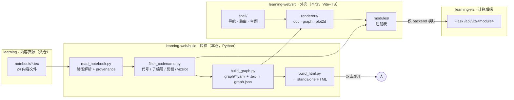

# learning-web — 设计

> **读者**：人 + 编码 agent ｜ **最后更新**：2026-09-22
> **本文放「设计」**：为什么这么分、契约长什么样、数据怎么流、A1 切片怎么验收。
> **规约不在这里** —— 硬规则、分级判据、红线一律看 `AGENTS.md`（入口文件），本文不重述。
>
> 真源约定（唯一一处定义，别处只引用）：
> - 硬规则与判据 → `AGENTS.md`
> - 笔记内容 → `../notebook/*.tex`（只读）
> - 语义边 → `graph/<chapter>.yaml`（本仓，见 `AGENTS.md` §3.4）
> - 进度与 Gate → `../dev-progress.md`

---

## 1. 决策记录

| # | 决策 | 理由 |
|---|---|---|
| D1 | **计算模块**的后端走 `learning-viz/python`（Flask `/api/viz/*`），本仓不自带相关后端 | 沿用父仓 `README.md` 的 `learning ← viz ← web` 三层；单一实现 |
| D2 | 前端 Vite + Vanilla TS，不上 React/Vue | 需要 HMR 调 Canvas/WebGL；单人维护，少一层心智模型 |
| D3 | 可视化计算按 `AGENTS.md` §2 的四问判据分级；**判据 Q1/Q2/Q3 命中即走后端** | 「后端算、前端看」；后端数据可 pytest 对拍 |
| D4 | 第一个切片只做 `A1`，但打穿整条链路（`.tex` → JSON → HTML → 外壳） | 防止全量铺开烂尾；A1 正是数学线 L1 当前所在 |
| D5 | 章节代号（`A1`、`G1.2`）作为路由 ID 与主键 | 绕开父仓 `AGENTS.md` 警告的 `§NN.N` 全局编号漂移 |
| **D6** | **笔记的转换链路整体放本仓 `build/`**（含 `filter_codename.py`、`build_graph.py`、`build_html.py`），不再有 `/api/notes/*` | standalone HTML 本就是纯静态产物、不经 Flask；放本仓不必为它拉起后端。**代价**：D1 的口径收窄为「计算模块走 viz」（AGENTS.md §10 Q2） |
| **D7** | 图谱语义边的真源放**本仓** `graph/<chapter>.yaml` | 与 `build/` 同仓迭代；脱节风险由 `notebook_commit` 校验兜住（AGENTS.md §3.4） |
| **D8** | 公式走**构建期 KaTeX 预渲染**（Node `katex.renderToString`），产物为静态 HTML | `pandoc --katex` 是客户端渲染且默认指向 CDN，与「离线 + 无闪烁 + 可搜 TeX」三项要求都不符（AGENTS.md §7 公式渲染） |
| **D9** | `json/` 词条库从三阶段人工流水线改为**全自动生成**（`TASKBOOK.md` 三 pass） | 人工阶段一正是「每问一次开一个 session」太慢的根源；生成物是可重建的构建产物，真源仍锚定 notebook |
| **D10** | §16.4 规则 5「不重述笔记」改为「生成物可重建：`tex_ref` 区间 + `notebook_commit` 锚定」 | JSON 是 notebook 的 max 版（原文 + 四问预答 + 可交互反例），不重述等于缺数据；可重建性由 pass 2 校验兜底 |
| **D11** | 语义边从「只能人工标注」改为「LLM 草拟 + 校验兜底（notebook_commit 比对、代号消失即失败、prereq 无环校验）」 | 197 个单元的边人工标注不可扩展；校验兜底把错误限制在可检出范围 |
| **D12** | web 外壳运行时 fetch `json/`（动态渲染），standalone 快照仍内联数据 | 改 JSON 秒级可见（开发回路）；`file://` 双击即开（分发）——两套产物两套契约 |
| **D13** | entry-card/v2：`content` 用 KaTeX、`tex_ref` 区间化 `{file, line_start, line_end}`、新增 `generated_by {model, date, reviewed}` 与 `probe` 类型、viz 三档状态机（无/前端直渲/留空待接）、直觉词条可挂 viz | 四问预答要可渲染就要公式与正文；多模型溯源与定向重审需要 `generated_by`；viz 分级避免前端硬啃后端级计算 |
| **D14** | P 篇（计算必修）特化：四问语义换装（quantifiers→适用条件表、反例→典型误用）、difficulty 从 tex 内嵌【必/熟/知】标记确定性提取、每个【必】小目 ≥1 道 probe、P10 决策树做交互词条 | P 篇是手算训练清单不是定理集，四问结构保留但语义必须适配；【必/熟/知】是比 ns-progress 更细的逐条真源 |
| **D15** | 无 `\subsubsection` 的文件（A3、D/E/F/L/M 全篇）以**整节为生成单元**（代号 `X#` 不带 `.k`）；subsection 无显式代号的文件（partN、de1–4、lie1–3）按**文件基名 + 全文件流水号**合成两级代号（`de1.1`、`lie2.3`），子目粒度优先 | 197 个单元必须全覆盖且代号只到两级；流水号合成的位移风险与 P 篇同源，由 `notebook_commit` 锚定兜底 |
| **D16** | LLM 调用走 **`codebuddy` CLI 直连多模型**（`deepseek-v4.1-flash` 批量生成 / `glm-5.3` 评审 / `kimi-k3-2` 仲裁），总控脚本 `build/orchestrate/pipeline.zsh`（现位于 `build/archive/`，见 D27）在 **WorkBuddy 之外的终端/tmux 运行**；WorkBuddy 会话内**禁止**嵌套执行 `codebuddy -p`（前台） | 实测（2026-09-24）：子 agent 通道只有 GLM-5.3（填其他型号名静默回退）；CLI `-p` 直连真实路由但嵌套进沙盒会假死且 `nohup+disown` 进程组必被回收。文件契约 + done 标记 + 外部总控是当时唯一稳定结构（后被 D17 补充） |
| **D17** | WorkBuddy 会话内执行用 **`codebuddy --bg` 托管后台会话 + transcript 回收**：pipeline.zsh 的 `wbdispatch/wbreview/wbcollect/wbstatus` 命令派发 `kb-<kind>-<code>` 命名的 `--bg` 会话，由 `build/orchestrate/collect_bg.py`（现位于 `build/archive/`，见 D27）从 `~/.workbuddy/projects/<cwd-slug>/<sessionId>.jsonl` 提取最后一条 assistant 输出落盘 | 实测（2026-09-24）：`--bg` 会话在沙盒里能跑完生成，但 `~/.workbuddy/logs/<name>.log` 恒 0 字节、`jobs/<id>/state.json` 的 state 常被误标 `failed`（进程被沙盒回收）——**transcript 是唯一可靠输出真源**，回收器按「PID 死活 + transcript 有无输出」判定，不信 state。D16 的前台禁令不变；外部终端 `batch*` 前台链路保留为备选（额度紧时两条路别同时跑） |

| **D18** | **双学科 = 同仓多入口**（`index.html` 数学 / `cs408.html` 408），数据根与语义边根完全分开；学科差异只出现在 `src/subjects.ts` 一张表里 | 若共用一个 hash 命名空间，`#/OS1.1` 与 `#/A1.3` 会迫使 `byCode` 全局唯一、字母块聚合混算、frontier 跨学科比较掌握度 —— 三处都要加学科维度且漏一处就串味。分入口后这三处**零改动**，代价只是多一个 HTML 与一个 3 行入口文件 |
| **D19** | **性能三条约定**：① 卡片 tab 懒渲染（首屏只拼 `.pane.on`）；② 阅读区分帧挂载（首卡同步、其余每帧 2 张，`renderToken` 防交错）；③ 公式缓存改有界 LRU（4000 条） | 实测（2026-10-30）全库首屏只需渲染 58.1% 的词条，最大的 A1.3 只需 18.6%；无上限的 `mathCache` 与 318 节点的侧栏整树重建是「浏览久了变卡」「点一下卡一下」的直接来源 |
| **D20** | viz 规格改**按需动态 import**（`viz/registry.ts` 只留 loader map，静态汇总迁 `viz/specs-all.ts` 供 Node 工具） | specs 源 237KB 全静态入主包，而多数单元不挂演示；拆包后主包 436KB → 350KB，specs 变成 2.5–25KB 的分包。**风险点**：Node 侧工具依赖静态汇总，所以 `specs-all.ts` 绝不能被浏览器入口 import（由 `check:viz` 的 loader/实现同步断言兜住） |
| **D21** | 单文件快照 `knowledge.html` 的内联数据改 **gzip + base64**，运行时用 `DecompressionStream` 解压（缺该能力时给明确文案，不白屏） | `file://` 不能 fetch，单文件无法按需取数据，只能压文本量：10.63MB → 4.35MB。实测这份语料（中文 + LaTeX）gzip 比只有 2.1–2.5:1，达不到当初估的 3.5:1，故预算由 4.2MB 修订为 4.5MB |

> **D12 复核（2026-10-30，方案 A）**：内容线已冻结（318/318，2026-09-25 收工），
> 「改 JSON 秒级可见」这条**从架构约束降级为开发期顺手** —— 它当初服务的是内容迭代，
> 该场景已两个月未发生。`json/` 的运行时角色保留，但理由变成「内容真源必须可达」，
> 不再是「内容天天在改」。据此定两种产物的定位：
> `dist/knowledge.html`（全内联）= **唯一分发物，双击即开**；
> `dist/index.html` / `cs408.html`（`type="module"` + 运行时 fetch）= **开发形态，必须 HTTP**。
> 「双击白屏」按打开错形态处理，不要再去修产物。
> 另：**`json/` 不得删除** —— 它是那 9.7MB 原创词条的唯一载体（tex 仅 5687 行，
> 直觉/反例/probe 均为生成物），等价于只读文件型数据库而非可重建的中间态。

| **D22** | **代号重排为三级可 Derive 体系**：`<域 2 字母><章 2 位>.<单元序>`（`AN03.2`），域 → 章 → 学习顺序全部由 `src/modules/taxonomy.ts` 的 `DOMAINS` 定义；旧代号整体废弃，留 `docs/codes-map-2026-10-30.md` 对照表供 `.tex` 同步 | 旧代号（A1/P3/de1/lie2/N9）是几次小任务各自加的，字母序既不是学习顺序也不是主题分组：侧栏 132 章平铺、看不出学科边界、318 个单元一次性入 DOM。代价是**一次性大迁移**（318 文件 / 318 词条 id / 1601 条 links / 56 个 yaml / 掌握度键），由 `tools/remap-codes.mjs` 统一完成并留痕 |
| **D23** | 派生依赖的先后判定**弃用字符串序**，改用 `cmpCode`（域序 → 章序 → 单元序） | 字符串序把 `CG` 排在 `EQ` 前、`MP` 排在 `NM` 前；重排后实测造出 5 节点环（PH09.1/PH22.1/PH24.1），环一出现拓扑序就覆盖不全（281/318），frontier 直接失效 |
| **D24** | 侧栏改**三层（域 → 章 → 单元）+ 单元懒渲染**；`<details>` 承载章，首次展开才插单元节点 | 318 个单元节点常驻 DOM，且每次掌握度变动都要整树重建 + 强制 reflow。改后首屏侧栏只有「当前章」的行数（通常 1–5 行），域/章进度条仍按全量元数据算，不依赖 DOM |
| **D25** | **总纲与切入点拆成两页**：`#graph` = 数学大观（四条主轴 / 两个出口 / 交叉点 / 五个切入点 / 四阶段），`#angles` = 原「现代分析学总纲 v3.0」 | 原 `syllabus.ts` 其实是作者选定的**一条**切入线（微积分 → 测度 → L^p → Sobolev），被误放在「总纲」位置。两者混在一起会让人以为「数学只有这一条路」 |

| **D27** | **生成线保留**（原「归档」撤回）：`build/` 的切片与生成脚本继续维护，用于「源改 → 重生成 `json/`」。当前代码在 `build/archive/`，需恢复到 `build/` 下可运行 | 原归档理由是「源不再需要」（旧 D26）+「人工校订会被覆盖」；现在源是 `.tex`，重生成是常态，这条线必须保留。`build/archive/` 内的历史版本可作实现参考 |
| **D26** | **`json/` 是 notebook 的构建产物**：每轮从 `.tex` 重新生成并覆盖，**改内容改源、不改 json**。`src.file` / `tex_ref` / `notebook_commit` 保留为溯源线索（`⌾ 溯源`） | 源始终是 `.tex`。早期按「解耦」定为唯一真源，但那样「改内容」与「重新生成」会互相打架；运行时不读笔记这一点不变（`src/` 只有 3 处显示），区别只在**谁是源** |

> **D6 与旧的 `learning-viz/python/notes_pipeline/` 方案冲突，以后者为准已废弃。**
> 该目录及其 `DESIGN.md` 已从 `learning-viz` 移除；`learning-viz` 只保留计算模块的后端
> （Flask `/api/viz/*`）与本地渲染。

---

## 2. 数据流



```
learning-web/
  build/
    verify_kb.py               # 内容校验器（npm run audit:content）—— 唯一还在用的脚本
    vendored/                  # KaTeX JS + CSS + 字体
    archive/                   # 生成线归档（D27）：切片/prefix/元信息/orchestrate/prompts/TASKBOOK
  docs/
    codes-map-2026-10-30.md    # 旧 → 新代号对照表（一次性迁移档案）
  graph/                       # 语义边真源（本仓）
    <chapter>.yaml
  src/                         # Vite + Vanilla TS
    shell/  renderers/  viz/  modules/  types.ts
  dist/                        # gitignore，可完全重建
    provenance.json
    notes/<code>.html          # 每节碎片
    graph/<chapter>.json
    graph/<chapter>.html       # standalone
  vite.config.ts
```

**两套产物互不依赖**：`build/` 出静态文件（离线可看），`src/` 出 web 外壳（要 dev server）。
先做 `build/`，能双击看到东西了再碰 Vite（`AGENTS.md` §12）。

> 2026-10-31 更新（D27）：`build/` 的静态产物（`notes/<code>.html`、`graph/<chapter>.json`）
> 已随生成线一起退役，现在只剩 `dist/knowledge.html` 这一份单文件快照由
> `tools/build-standalone.mjs`（Node，不是 Python）产出。

---

## 3. 溯源：`dist/provenance.json`

```json
{
  "notebook_repo": "/Users/apple/develop/learning",
  "notebook_commit": "66ce26a",
  "notebook_dirty": false,
  "built_at": "2026-09-22T17:20:00+08:00",
  "files": ["A_analysis.tex", "G_numeric.tex"],
  "pandoc_version": "3.x",
  "katex_version": "0.16.x",
  "converter_version": 1
}
```

用途有三，缺一不可：

1. **判断本仓产物是否比笔记旧** —— `notebook_dirty: true` 或 commit 变化即需重建；
2. **校验 `graph/*.yaml` 是否过期** —— 与 yaml 头部的 `notebook_commit` 比对，不一致要告警（`AGENTS.md` §3.1）；
3. **可复现** —— `converter_version` + `pandoc_version` + `katex_version` 三者固定，产物才可复现，
   也才能在 KaTeX 升级后定位「是哪一步改了排版」。

> **2026-11-17 口径**：生成者改为 `tools/write-provenance.mjs`（`npm run build` 的最后一步）。
> 原 Python 生成线 2026-10-31 退役后该文件**没有生成者**，字段随之收敛到当前实际存在的四项：
> `notebook_repo` / `notebook_commit` / `notebook_dirty` / `built_at`（外加 `generator`）。
> `pandoc_version` / `katex_version` / `converter_version` 属旧 Python 线，Node 线没有对应步骤，
> **不再写空值冒充**；`files` 固定为 `[]`（逐个文件出处已在各 `json` 的 `src.file` 里，不设第二份清单）。

---

## 4. 契约

### 4.1 通用规则

- 每个模块**独立契约 + `version`**（父仓 `README.md` 原则）。
- **必须批量**：一次返回整个参数区间，前端本地 scrub；拖滑块不得逐帧请求。
- 前端计算的模块**必须**带 `computedBy` 并在 UI 上标徽章（`AGENTS.md` §2.3）。
- 契约是**纯数据**：只有数字与字符串，不含函数、不含样式、不含绘制指令。
- **不向后不兼容地改**已定稿的 version（`AGENTS.md` §8 红线）。

### 4.2 消费方与数据源

| 模块 `source` | 取数方式 | 契约产出方 | 正确性保障 |
|---|---|---|---|
| `'frontend'` | 本地 TS 模块直接返回契约对象 | 本仓 `src/viz/*.ts` | 模块内 **invariant 自检** + UI 徽章 |
| `'backend'` | `GET /api/viz/<module>?<params>` | `learning-viz` | `learning-viz` 侧 pytest 对拍 |

两者返回**完全一致的 JSON**，所以迁移只改注册表的 `source` 一个字段（`AGENTS.md` §2.2）。

### 4.3 样例：`convergence-thm`（A1 切片，**前端**实现）

按 `AGENTS.md` §2 判据：Q1 父仓无实现、Q2 弱（∫f_n ≡ 1 显然）、Q3 无 → **前端**。

```json
{
  "module": "convergence-thm",
  "version": 1,
  "computedBy": "frontend",
  "params": { "mode": "bump", "n_min": 1, "n_max": 40 },
  "series": [
    { "n": 1,  "xs": [0, 1],        "ys": [1, 0],       "integral": 1.0 },
    { "n": 40, "xs": [0, 0.025, 1], "ys": [40, 40, 0],  "integral": 1.0 }
  ],
  "assumptions": { "nonneg": true, "monotone": false, "dominated": false },
  "verdict": { "mct": false, "dct": false, "fatou_holds": true },
  "note": "质量挤入宽 1/n、高 n 的尖峰；sup_n f_n 在原点附近无界，无可积控制函数"
}
```

三条必须遵守的约束（**不是建议**）：

1. **批量**：一次给 n ∈ [1,40] 全部序列，不是一条一条取。
2. **`assumptions` 与 `verdict` 由计算方算**，不是前端写死的文案 ——
   这样「假设检查」本身可以被断言（前端走 invariant 自检，后端走 pytest）。
3. **invariant 自检**：`bump` 模式下每条 series 的 `integral` 必须精确等于 1.0，
   偏差 > 1e-12 **抛错**，不静默画图（`AGENTS.md` §2.3）。

> **为什么 A1 切片选前端**：`A1.3`（三大收敛定理）与 `A1.4`（测度论基础）的演示
> 都是「抽掉一个假设看结论怎么失效」，是纯函数图像 + 离散对比，
> 命中判据 Q4，且父仓没有现成实现 —— 放前端才有零往返的拖拽手感。

### 4.4 后端契约的差异

`source: 'backend'` 时 JSON 结构与上例完全一致，只有两处不同：

- `computedBy: "backend"`；
- 取数走 `GET /api/viz/<module>?...`（`learning-viz` Flask，dev 下由 Vite proxy 转发）。

`A1.3`/`A1.4` 之外、命中判据 Q1/Q2/Q3 的模块（如 `G1.2` RK4 vs Verlet）一开始就走后端，
不存在「先前端后迁移」这一步。

---

## 5. A1 垂直切片：验收步骤

> 与 `AGENTS.md` §12 的开工顺序同源，这里只写**验收判据**。
> **每步完成后停下报告，不要连续执行。**

| # | 做什么 | 验收（可执行） |
|---|---|---|
| 1 | `uv add --dev pypandoc-binary`（落在**父仓** `pyproject.toml`） | `uv run python -c "import pypandoc; print(pypandoc.get_pandoc_version())"` 有输出 |
| 2 | `build/read_notebook.py` + `provenance.json` | `dist/provenance.json` 的 `notebook_commit` 与 `../notebook` 的 `git rev-parse --short HEAD` 一致；`notebook_dirty` 正确反映未提交改动 |
| 3 | `build/filter_codename.py`（正则 `[A-R]`）→ 转 A1 | 得到 `A1`、`A1.1`…`A1.5` 共 6 个节点且父链正确；`src.line` 与源文件 `grep` 对得上；**逐一目视比对** `tabular`（A1 内 3 张）/ `\boxed`（1 处）/ 公式上下标，不可只抽查一个 |
| 4 | 手写 `graph/A1.yaml` | 覆盖 A1 的 5 个小目；含 `tension` / `dual` 语义边；`prereq` 子图**无环**（能算出 frontier）；头部 `notebook_commit` 与步骤 2 一致 |
| 5 | `build/build_graph.py` | `dist/graph/A1.json` 里四类边齐全且可分辨；`prereq` 拓扑排序成功；节点 `code` 全部是两级代号 |
| 6 | `build/build_html.py` | `dist/graph/A1.html` **双击**（`file://`）即开：无白屏、无 console 报错、**网络面板无外部请求**（验证 §3.1 三条约束） |
| 7 | 此后才动 `src/`：shell → renderers → viz 注册表 | dev 下 `/api` 代理通；拖滑块**无网络请求**（批量已取回）；徽章与 `computedBy` 一致 |

**步骤 1–3 完成就应能在浏览器里看到一个公式**（打开的是一节 HTML 碎片），
不要等 7 步全做完。步骤 6 的 standalone HTML 是**第一个能拿给人看的东西**。

### 选 A1 的理由

1. `../learning-todo/ns-progress.md` 当前正卡在 **Vitali → Carathéodory → 积分四步构造**，
   恰好落在 `A1.4`；这三关是全篇最适合可视化的（外测度方盒覆盖、Vitali 等价类选择、简单函数逐步逼近）；
2. A1 是全篇地基（A 与 B 是两个根，其余章节全部依赖）；
3. 内容量适中（`A1` 共 5 个小目：A1.1 黎曼→A1.5 L^p），一周可见成果。

**做完切片，学习进度与工程产出是同一件事。**

---

## 6. 本文与 AGENTS.md 的边界

| 内容 | 放哪 | 理由 |
|---|---|---|
| 硬规则、四问判据、红线、命令、目录 | `AGENTS.md` | agent 每次都要遵守，必须短 |
| 决策记录（为什么这么分）、契约样例、数据流、验收判据 | 本文 | 只在动手改契约/渲染器时才读 |

`AGENTS.md` 只放「每次会话都要遵守的规约」；本文放「只在动手改某模块时才要看的」。
超过阈值就整节外移到本文，入口只留指针（阈值与现状见 `AGENTS.md` §11）。

---

## 7. 附录 A：2026-09-22 评审校正记录（C1–C9）

> 本文档体系落地时，起草稿依据的是**旧快照**。以下为实测校正，
> `AGENTS.md` 正文相应处标 `[校正 Cn]`，此处保留完整来龙去脉。

| # | 原文 | 实测 / 决定 | 影响 |
|---|---|---|---|
| C1 | 「全笔记 36 节，概念节点预计 250+」 | **24 个内容 `.tex`**（A–R 16 篇 + `partN` + `de1–4` + `lie1–3`）、**202 个 `\subsection`**、**162 个 `\subsubsection`**、`main.pdf` **112 页** | 节点规模按章节实测后再定，不要沿用「250+」 |
| C2 | `A1.1.3` / `A1.1.4` | **不存在三级代号**，只到 `X#.k`。三大收敛定理 = **`A1.3`**；σ-代数 / 外测度 / Vitali 全在 **`A1.4`**（A1 的第 4 个小目「测度论基础」） | 节点主键与路由直接错位 |
| C3 | R1「Python 3.14 缺 wheel」标 **高** | **实测解除**：`pypandoc-binary 1.17` 有 `py3-none-macosx_11_0_arm64.whl`（`py3-none` 纯标签）、`flask 3.1.3` = `py3-none-any`、`flask-caching 2.5.1` 需 `>=3.11` | 风险 **高 → 低**；**不要**为它改 `.python-version` |
| C4 | `\providecommand` 只加 `notebook/math/main.tex` | 要加**两处**：`notebook/math/main.tex` 与 `notebook/math/bridges/main.tex`（后者可独立编译） | 子文档编译报 `Undefined control sequence` |
| C5 | 「Python 一律走父仓的 uv 环境」 | 已实测成立：在 `learning-web/` 下 `uv run` **向上发现父仓项目**，用 `~/develop/learning/.venv`。故 `uv add` 写进**父仓** `pyproject.toml` + `uv.lock`，本仓不建自己的 `pyproject.toml` | 依赖提交要在**父仓**做 |
| C6 | `vendored/` = KaTeX CSS + 字体 | 若走客户端渲染还需 **`katex.min.js`**，且**首屏会闪一次**；`pandoc --katex` **不是**服务端渲染 | 触发决策 D8（构建期预渲染） |
| C7 | R3 三类结构一起点名 | A1 段内实测 **3 张 `tabular`（均 `L{}` 定宽列）+ 1 处 `\boxed`**；**`\xrightarrow` 不在 A1**，集中在 `C_partial`(7)、`de4`(8) 与 `P`/`Q`/`lie1–3`(各 1) | 目视比对要**按章分摊**到这些文件 |
| C8 | §10 问题 Q1：语义边放父仓 | **已决：本仓** `graph/<chapter>.yaml` | 原文「为什么放父仓」的论证整体反转 |
| C9 | §10 问题 Q2：build 脚本放哪 | **已决：本仓 `build/`** | 与 D1「统一后端」有张力，口径已收窄 |

---

## 8. 节点数据结构与掌握度

### 8.1 接口定义

```ts
interface ConceptNode {
  id: string;                    // 'sigma-alg'
  code: string;                  // 'A1.4'  ← filter 从 .tex 抽取（两级，见 AGENTS.md §1.3）
  src: { file: string; line: number };   // 反查真源
  title: string;
  question: string;              // 「在解决什么」—— 必填，不可留空
  difficulty: 'green'|'yellow'|'red';   // 内容难度，来自 ns-progress
  mastery: 0|1|2|3|4|5;          // 掌握度，与难度**正交**
  edges: {
    prereq: string[]; tension: string[];
    dual: string[]; applies: string[];
  };
  probes: Probe[];
  viz?: { module: string; source: 'frontend'|'backend'; version: number };
}

interface Probe {
  level: 1|2|3|4|5;
  text: string;                  // 可操作的检验问句
  viz?: string;                  // 关联的演示模块
  status: 'todo'|'done';
}
```

### 8.2 四类边

| 边类型 | 语义 | 是否允许成环 | 用途 |
|---|---|---|---|
| `prereq` | 学习顺序 | **必须无环**（否则算不出 frontier） | 「今天该学什么」 |
| `tension` | 反例 / 约束冲突 | **允许且常见** | 闭环视图 |
| `dual` | 对偶路径（自顶向下 ↔ 自底向上） | 允许 | 闭环视图 |
| `applies` | 下游应用 | 允许 | 反向链接 |

`prereq` 与其余三类混在一张有向图里，拓扑排序与 frontier 计算即失效。
渲染时用颜色 + 线型区分，可分别开关。

### 8.3 掌握度分级（可操作判据）

`difficulty` 是**内容有多难**，`mastery` 是**你学到哪一级**，两者正交，UI 必须同时编码。

| 级 | 判据 | 检验方式 |
|---|---|---|
| **L0** | 未接触，名词不认识 | — |
| **L1** | 能复述定义 | 填空 |
| **L2** | 能说动机（为什么是这三条） | 口述 |
| **L3** | **能给反例 / 指出约束为何不能更强或更弱** | 交互演示 |
| **L4** | 能证明 | 手写 |
| **L5** | 能连接下游（这块支撑了什么） | 说出依赖它的结论 |

**L3 是分水岭**：反例是主动构造的知识，不是被动接收的，也是前端唯一能大幅超越 PDF 的地方。

> **产品取向由此确定**：以「反例 / 失效演示」为一等公民，不以「定义 / 定理」为一等公民。
> 这是与 Obsidian / Notion / mdBook 的根本分野 —— 它们假设内容是静态文本，
> 而本仓内容里最值钱的部分是「这个约束为什么不能更强 / 更弱」。

### 8.4 frontier 计算

```
frontier = { n | n.mastery < 3 且 n 的所有 prereq 满足 mastery >= 3 }
下一步   = frontier 按拓扑序取第一个
```

「今天该学什么」是**算出来的**，不是写死的 —— 这样它永远不会与掌握度状态脱节。

---

## 9. 规模与呈现

### 9.1 standalone HTML 的三条硬约束

`file://` 协议下浏览器限制严格，**三条全中会直接白屏**：

| 约束 | 原因 | 做法 |
|---|---|---|
| **不能 fetch 本地文件** | `file://` 跨源被拦 | 数据以 `<script type="application/json" id="graph-data">` **内联** |
| **不能用 ES module** | `type="module"` 在 `file://` 下受 CORS 限制 | 构建产物用 IIFE，不用 `import` |
| **不能用 CDN** | 断网即废；父仓要求产物本地化 | KaTeX / Mermaid / 图表库全部内联或 vendored |

> Vite 用 `build.lib` + inline 插件产出单文件；或构建时手写模板注入 JSON。
> **不要**指望「本地起个 server 就好了」—— standalone 的价值就在于双击即开。

### 9.2 三层语义缩放

全笔记实测 **202 个 `\subsection`、162 个 `\subsubsection`**（见 §7 的 C1），
概念节点数按章节实测后再定。一次性全画必卡且不可读：

| 层级 | 显示 | 触发 |
|---|---|---|
| 全局 | 只显示 A–R 字母块 + 进度色 | 默认 |
| 章节 | 展开该节的概念节点 + 四类边 | 点击字母块 / 指定 `--chapter` |
| 节点 | 探针、源文件行号、挂载的演示 | 点击节点 |

**生成命令按章节切分**：`build.py --chapter A1`，不默认全量。

### 9.3 实测规模与性能判据（2026-10-30）

| 指标 | 改动前 | 改动后 | 量法 |
|---|---|---|---|
| 首屏渲染词条占比 | 100% | **58.1%**（A1.3 仅 18.6%） | 按 tab 分组统计 `statement` 组 / 全部 |
| 切换单元首卡时延 | — | 96–139ms | `dom-harness` 的 `runRace` 打点（jsdom） |
| 切换单元全部就绪 | — | 560–1015ms | 同上（**jsdom 口径**，真浏览器另测） |
| 主包（含 KaTeX） | 436KB | **350KB** | `vite build` 输出 |
| 分包（specs） | 全在主包 | 2.5–25KB × 12 | 同上 |
| `dist/assets` 字体 | 1.02MB（woff2+woff+ttf） | **250KB**（仅 woff2） | `du -sh dist/assets` |
| `knowledge.html` | 10.63MB | **4.35MB** | 构建日志 |
| 掌握度点击的侧栏 DOM 变更 | 318 节点整树重建 | **≤3 节点** | `dom-harness` 的 MutationObserver 断言 |

> **时延阈值按 jsdom 口径放宽**（首卡 400ms / 全部就绪 1600ms）：jsdom 没有真实排版引擎、
> 单元 JSON 走磁盘同步读，同一份代码连跑三次能差 2.5 倍。它只当**回归护栏**；
> 真浏览器预算仍是首卡 200ms / 全部 800ms。

---

## 10. 语义边真源：取舍、校验与字段

### 10.1 三条缓解细则（`AGENTS.md` §3.1 的展开）

1. 每份 `graph/<chapter>.yaml` 头部记 `notebook_commit`（建立该文件时的 `../notebook` HEAD）；
2. `build_graph.py` 把该值与 `dist/provenance.json` 的 `notebook_commit` 比对，
   不一致即**告警并拒绝静默通过**（提示「语义边可能过期，请复核」）；
3. 该 yaml 覆盖的章节代号若在 `.tex` 里消失/改名，**构建直接失败**，不降级。

### 10.2 为什么放本仓（与备选方案的取舍）

| 方案 | 好处 | 代价 |
|---|---|---|
| 父仓 `../notebook/graph/` | 与笔记同步演化，天然不漂移 | 改图谱要跨仓提交；`notebook/` 会混入「构建元数据」 |
| **本仓 `graph/`（已选）** | 与 `build/` 同仓迭代，改起来顺手 | `.tex` 改了、本仓可能忘了改 → 由 §10.1 兜住 |

### 10.3 yaml 字段样例

```yaml
# graph/A1.yaml
chapter: A1
notebook_commit: 66ce26a        # 建这份 yaml 时 ../notebook 的 HEAD（§10.1 用于校验）
nodes:
  - id: sigma-alg
    code: A1.4                  # 只到两级（A1 的第 4 个小目「测度论基础」）
    title: σ-代数
    question: 为什么不能对 R 的所有子集都定义「长度」？
    difficulty: green           # 沿用 ns-progress 的 green/yellow/red
    probes:
      - level: 1
        text: 写出三条性质
      - level: 3
        text: 若对任意并封闭会退化为什么
        viz: sigma-alg-degenerate
edges:
  - { from: four-constraints, to: sigma-alg, kind: prereq }
  - { from: vitali, to: sigma-alg, kind: tension }
  - { from: caratheodory-sigma, to: sigma-alg, kind: dual }
```

---

## 11. 判据的应用

### 11.1 逐模块判据结论

| 演示 | 判据 Q1 | Q2 | Q3 | 结论 |
|---|---|---|---|---|
| `A1.3` 三大收敛定理反例 | 无 | 弱（∫f_n ≡ 1 显然） | 无 | **前端** |
| `A1.4` 外测度方盒覆盖 | 无 | 无 | 无 | **前端** |
| `B1.2` Rodrigues 公式 | **有** `core/rotate.hpp` | — | — | **后端** |
| `G1.2` RK4 vs Verlet 能量漂移 | **有**（`plan.md` 阶段 1） | **是** | **是** | **后端** |
| `H4` 重要性采样方差 | 无（暂无） | 弱 | 无 | **前端起步**，C++ 加采样器后迁移 |
| `I` 流体力学全部 | 部分有 | 是 | 是 | **后端** |

### 11.2 前端计算的严谨性细则

前端算的数值**没有 pytest 对拍**，必须显式补偿：

1. 每个前端计算模块内置 **invariant 自检**（如 `bump` 模式下 `∫f_n ≡ 1` 必须精确成立，
   偏差 > 1e-12 直接抛错，不要静默画错图）；
2. 契约响应带 `"computedBy": "frontend"`，渲染时在角上标一枚 `前端计算·未对拍` 徽标；
3. 涉及数学结论的数值一律走后端 —— 见 `AGENTS.md` §2 判据 Q2。

### 11.3 迁移只改一个字段

```ts
const src = REGISTRY[module].source;   // 'frontend' | 'backend'
const data = src === 'frontend'
  ? await localCompute(module, params)          // 返回同一 schema
  : await fetch(`/api/viz/${module}?${qs}`);    // 返回同一 schema
```

**契约 schema 是分级机制的粘合剂**：前后端返回完全一致的 JSON，
切换只改注册表一个字段。这是允许「先前端后迁移」的前提。

---

## 12. probes 的三级数据来源

节点数量大（§9.2），手写探针不现实。按此顺序取：

| 来源 | 覆盖 | 成本 |
|---|---|---|
| **会话日志抽取**：`ns-progress.md` 的检验题 + `chats/*.ipynb` | 已学章节的 L2–L3 探针，**自带 ⏳/✅ 状态** | 一次性脚本 |
| **`.tex` 的 `\textbf{}` 关键句** | 自动生成 L1「能复述吗」探针 | filter 顺手做 |
| **人工** | red 难度节点的 L4 证明探针 | 只写少数高价值节点 |

> `ns-progress.md` 里已有现成例子：
> `⏳ 检验题已出待答：DCT 的盖子分别用什么机制封死…` / `✅ DCT 盖子检验题结清：…`
> —— 这就是带状态的 L3 probe，直接可解析。

### 12.1 掌握度写回

本仓**只读** `ns-progress.md`。用户在前端改掌握度后：

1. 生成一段符合该文件日志格式的 markdown（日期 | 话题 | 覆盖 | 检验结果）；
2. 展示给用户 review；
3. 由用户粘贴提交。

**不直接写文件** —— 该文件是 append-only 真源，且属独立子仓
（父仓红线：三子仓改动只能在各自仓内提交）。

---

## 13. 风险明细

| # | 项 | 等级 | 处置 |
|---|---|---|---|
| R1 | Python 3.14 下 flask / pypandoc-binary 是否有 wheel | **低**（原标「高」，见 §7 C3） | 无需处置。仍**不改 `.python-version`、不用系统 python** |
| R2 | `pypandoc-binary` 自带 pandoc 版本与 filter 接口是否匹配 | 中 | 退路 `brew install pandoc` + `pypandoc`；**只装一个**。本机 `pandoc` 未装（`pypandoc-binary` 自带可执行文件） |
| R3 | pandoc / KaTeX 对 `tabular`（`L{}` 列）、`\boxed{}`、`\xrightarrow` 的保真度 | **高** | 三类结构分布见 §7 的 C7。转换后**逐文件目视比对**，不可只抽查一个公式 |
| R4 | 合成的 `X#.k` 子编号漂移 | 低 | `AGENTS.md` §1.3 对策：稳定锚点显式写代号，filter 优先采信 |
| R5 | 语义边放本仓 → `.tex` 与本仓 `graph/*.yaml` 脱节 | 中 | §10.1 三条缓解：校验不静默、不降级 |
| R6 | 大节点量全图渲染性能 | 中 | §9.2 语义缩放 + 按章节切分，不默认全量 |
| R7 | `dist/` 与 `.tex` 漂移 | 中 | `provenance.json` 记 commit hash；`notebook_dirty: true` 即需重建 |

---

## 14. 未决问题（不阻塞开工）

| # | 问题 | 倾向 | 代价对比 |
|---|---|---|---|
| Q3 | 搜索是否上索引库（lunr / minisearch）？ | 起步用**朴素子串匹配** | 202 节规模下够用；上索引库是过早优化 |
| Q4 | 掌握度是否引入间隔重复（Anki 式调度）？ | **暂不** | probes 已有 `status`，调度算法是另一套复杂度；先验证探针本身有效 |
| Q5 | 是否需要 dark mode？ | 用 CSS 变量，跟随系统 | 成本低，且 graph 配色需两套 |

---

## 15. 公式渲染实现细节

`AGENTS.md` §7 给了三条硬规则，这里是落地细节（决策 D8）。

1. **pandoc 只出片段**：调 `pandoc -f latex -t html` 时**不要加 `-s`** ——
   加了就会注入指向 KaTeX CDN 的 `<script>` / `<link>`，违反禁 CDN。
2. **用构建期 Node 预渲染**：解析片段里的 `\(...\)`（行内）与 `\[...\]`（行间），
   逐个交给 `katex.renderToString(tex, { output: 'htmlAndMathml', throwOnError: false })`，
   用返回值替换原片段。实测收益：
   - 离线（无 JS 运行时依赖）；
   - 无首屏闪烁（服务端已排版）；
   - 产物自带 `<annotation encoding="application/x-tex">`，搜索索引直接提取原始 TeX。
3. **错误处理**：`throwOnError: false` 让单条公式失败时退化显示源码而**不中断整章构建**，
   但要**同时把失败项写进构建日志并计入非零退出码的警告**，否则会静默产出残缺页面。
4. **`vendored/` 仍需保留 `katex.min.css` 与字体**（只有 CSS，不需要 JS）——
   静态 HTML 里的类名要靠它上样式。
5. **若退化为客户端渲染**（不推荐）：保留 `katex.min.js`，接受首屏闪烁与 JS 依赖；
   此时 standalone HTML 更要遵守 `AGENTS.md` §3.1 三条约束。

---

## 16. 学习词条占位库：`json/`（阶段一，2026-09-23 建立）

> **定位**：本目录是「学习过程中产生的关键词占位符」，**不是构建产物、不是第二份笔记内容**。
> 它由学习会话随手追加（agent 职责：记笔记、记关键词），后期由 AI 补全（阶段二），
> 再交给 web 前端引用做可视化演示（阶段三）。

### 16.1 三阶段流水线

| 阶段 | 做什么 | 谁做 | 状态 |
|---|---|---|---|
| **1 记录** | 学习中出现值得展开的词条 → 往 `json/<chapter>/<code>.json` 追加 entry（只填关键词，`content: null`） | 学习会话 agent | **进行中** |
| **2 补全** | 按 `keywords` + `fill_hint` 把 `content` 写成完整文本（定理、证明、直觉、反例计算） | AI 批量处理 | 未开始 |
| **3 可视化** | 前端引用词条渲染（点开代号显示词条列表），`type: "viz"` 的 entry 挂 `viz.module` 接渲染器 | `src/` + `learning-viz` | 未开始 |

**阶段一只许记关键词，不许写 `content`** —— 关键词是「告诉后续 agent 该补什么」的指令，
现在写满反而把半成品当成品。

### 16.2 目录与文件约定

```
json/
  <chapter>/            # 章节代号作目录名，与 notebook 对应：A1、B1、C6、H4…
    <code>.json         # 一个 \subsubsection（小目）一个文件，如 A1.3.json
```

- 章节信息真源 = `../notebook/*.tex`（A–R 16 篇 + `partN` + `de1–4` + `lie1–3`）。
- **代号只到两级**（`AGENTS.md` §1.3）：`A1.3.json` 合法，`A1.3.2.json` 非法。
- 一个文件 = 笔记里一个小目的全部词条；词条用 `id` 区分（见 16.3）。

### 16.3 词条（entry）schema v1

```json
{
  "id": "A1.3:mct.intuition",      // "<code>:<subject>.<slot>"，文件内唯一
  "type": "intuition",             // 见下表枚举
  "subject": "mct",                // 同文件内的分组键（mct/fatou/dct/general…）
  "title": "人读的一句话标题",
  "seed": "可选：用户原话/会话摘录，保真记录直觉来源",
  "keywords": ["关键词/短语/公式骨架，逗号列表"],   // 阶段一的核心产出
  "tex_ref": { "file": "A_analysis.tex", "line": 48 },  // 可选：指向 .tex 真源行
  "viz": { "module": "convergence-thm", "version": 1 }, // 可选：阶段三挂演示
  "fill_hint": "给阶段二 AI 的补全指令：补什么、参照什么、注意什么",
  "links": ["A1.4", "C6.3"],       // 可选：跨词条引用（两级代号）
  "content": null,                 // 阶段一恒为 null；阶段二填完整文本
  "status": "seed"                 // seed(阶段一) → drafted(阶段二) → reviewed → published(阶段三)
}
```

`type` 枚举（前端按此决定渲染样式，**不自由发挥**）：

| type | 含义 | 例子 |
|---|---|---|
| `statement` | 定理/定义的精确陈述 | MCT 条件与结论 |
| `proof` | 证明骨架 | Fatou 的 g_n = inf 构造 |
| `intuition` | 直觉/物理图像 | 「沿 n 的变化方向固定非负」 |
| `extension` | 拓展：假设放宽/加强会怎样 | MCT 递减怎么办 |
| `counterexample` | 反例 | 尖峰挤零测点、滑动质量 |
| `comparison` | 多概念对照 | 三定理条件/结论对比表 |
| `application` | 下游应用 | H4 MC 积分依赖 DCT |
| `viz` | 演示槽位（阶段三用） | convergence-thm 模块挂点 |

### 16.4 硬规则

1. **JSON 必须机器可读**：每次改动后 `uv run python -m json.tool <file>` 能过（在父仓目录跑，§6 校正 C5）。不追求人的可读性，但追求 schema 一致性。
2. **阶段一只追加不删改**：`keywords`/`seed`/`fill_hint` 可以补充，已写的不重写 —— 与 `.ipynb` 追加原则同源。
3. **`content` 在阶段二之前恒为 `null`**，`status` 恒为 `"seed"`。阶段二才改 `drafted`。
4. **公式写法**：`keywords` 里公式用 ASCII/Unicode 骨架（`∫ f_n dμ`、`f_n ↑ f`），**不写裸 LaTeX**（父仓 `AGENTS.md` 第五节）；需要精确公式时用 `tex_ref` 指回 `.tex`，不抄第二遍。
5. **不重述笔记内容**：`.tex` 已有的陈述（如三大定理的 tabular）只记 `tex_ref` 行号，`keywords` 记「转写时要补什么」，**不复制原文** —— 第二份等效数据是漂移的起点（§0 真源约定）。
6. **`seed` 字段保真**：用户口头给出的直觉（哪怕不严格）原样记进 `seed`，阶段二再精修。这是本库最值钱的字段 —— 它记录的是「学的人当时怎么想的」。
7. **`links` 只用两级代号**；指向的文件可以尚不存在（阶段二/三再建）。

### 16.5 首份样例

`json/A1/A1.3.json`（三大收敛定理，39 个词条），是 schema 的活文档 ——
新文件照它的结构写。其中 `general.viz` 词条已预留 `convergence-thm` 模块挂点
（契约样例见 §4.3，分级结论见 §11.1），阶段三直接对接。

### 16.6 反例要挂在**限定词**上，不只挂教科书经典反例

用户 2026-09-23 明确要求：「反例不仅要有教科书的经典反例，还可以关联到定理的每个细节」。

这是本库的**产品取向**（与 §8.3「反例是一等公民」同源）：一个定理的价值不在陈述，
而在**每条限定词为什么不能更强或更弱**。所以每个核心定理除常规词条外，**必须**有一条
`type: "comparison"`、`id` 以 `.quantifiers` 结尾的**限定词拆解**词条，把陈述拆成
n 个限定词，每个限定词配「去掉后的具体反例 + 结论如何失效 + 能否放宽」。

**硬要求**：每行必须给**具体函数**（`f_n = −1_[n,∞)`），禁止写「存在反例」了事。

`A1.3` 的两条样例：`mct.quantifiers`（5 个限定词）、`dct.quantifiers`（6 个限定词）。
它们各自指向的定点反例词条：

| 限定词 | 反例词条 | 构造 |
|---|---|---|
| MCT 的 `f_n >= 0` | `mct.nonneg` | `f_n = −1_[n,∞)`：单调升 ↑ 0 但 `∫f_n = −∞` |
| MCT 的 `<=`（非 `<`） | `mct.strict-incr` | 常数序列 `f_n ≡ 1_[0,1]` 被严格版排除；证明只用 `<=`；**不能靠严格化补救**（加项改极限、减项破非负） |
| MCT 的可测性 | `mct.measurable` | `1_V`（Vitali 集）不可积；但 `sup f_n` 的可测性是**推论**（可数并封闭） |
| DCT 的 `a.e.` | `dct.why-ae` | 逐点太强、依测度更弱仍成立；例外集可依赖 n 靠**可数次可加**兜住 |
| DCT 的 `<= g` 对**所有 n** | `dct.unif-in-n` | 量词顺序 `∀n ∃g_n` vs `∃g ∀n`；bump/slide 各是前者的实例 |
| DCT 的 `|f_n| <= g`（绝对值） | `dct.abs-value` | `f_n = −n·1_(0,1/n)`：`f_n <= g` 成立但 `|f_n| <= g` 不成立，`∫f_n = −1 ↛ 0` |
| DCT 的 `g ∈ L^1` | `dct.g-integrable` | 三种松法：`g ≡ ∞` / `g` 有界但 `μ(X) = ∞` / `1/x` 与 `1/√x` 差一个幂次 |

> **写词条的顺序建议**：先写 `.quantifiers` 拆解（它决定还需要哪些反例），
> 再逐条建定点反例词条，最后写 `intuition` / `proof`。反过来做容易漏掉限定词。

### 16.7 数值核验：反例里的数字必须算过

`keywords` 里出现的**任何数值**（`∫f_n` 的值、`‖f_n − f‖_1`、发散率）都必须先核验再写，
不许估。核验方式：父仓 `uv run python` + numpy 梯形积分，或解析算。

已核验并写进 `A1.3` 的数据（阶段二补全时直接引用，不要重算）：

| 序列 | `∫f_n` | `‖f_n − f‖_1` | `∫sup_{n<=N}` |
|---|---|---|---|
| `n·1_(0,1/n)`（bump） | `≡ 1` | `≡ 1` | `1 + ln N`（N=4,8,16,64 → 2.3863, 3.0794, 3.7726, 5.1589） |
| `1_[n,n+1)`（slide） | `≡ 1` | `≡ 1` | `N`（线性） |
| `(1+x/n)^n·e^(−2x)`（exp） | n=1,2,5,10,50,200 → 0.75, 0.8125, 0.8866, 0.9294, 0.9817, 0.9951 → `1` | 0.25, 0.1875, 0.1134, 0.0706, 0.0183, 0.0049 → `0` | `1`（收敛，盖子 `g = e^(−x)`） |
| `−n·1_(0,1/n)`，`g = 1_[0,1]` | `≡ −1` | — | `f_n <= g` 处处成立、`|f_n| <= g` 不成立 |
| `(1/x)·1_(1/(n+1),1/n)`（UI 无盖子） | `ln(1+1/n) → 0` | — | `sup_n f_n = 1/x`，`∫ = ∞`；`sup_n ∫_{f_n>M} = ln(1+1/M) → 0` ⟹ **UI 成立** |

> **教训（两条，都发生在本库建立当天）**：
> 1. bump/slide 的 `‖f_n − f‖_1` 是 `1` 不是 `2`（因 `f ≡ 0`）。
> 2. 初稿举的「UI 但无可积盖子」例子 `f_n = n·1_(0,1/n^2)` 是**错的** ——
>    实测 `∫sup_n f_n = 1.6445 ≈ π^2/6` 有限，它其实**有**可积盖子。
>    正确例子是上表的 `1/x` 切片版。同类地，「单调升列可严格化」的说法也错：
>    加严格升项会改变极限、减则破坏非负，`<=` 无法化归为 `<`。
>
> **规矩**：反例的每一个断言（尤其是「存在/不存在某物」这类否定断言）都要**先算后写**。
> 举反例最容易犯的错不是算错数字，而是**举了一个不满足前提的例子**。
> 父仓硬规则「正确性第一」在词条库同样适用 —— 口头报数前算一遍。

---

## 17. 导读层（guide-card/v1，2026-11-20 建立）

### 17.1 问题

单元页从「标题」直接跳到「考法/真题」，第一次读的人拿不到三样东西：

1. 这块知识为什么存在（没有它时哪一步做不下去）；
2. 整块的一条统一原则（不是逐条定义的复述）；
3. 它往后接到哪（下一章的真实代号）。

这三样在 `build/reading/talk/` 的口述稿里有，但口述稿是给耳朵的：公式被转成口语、
矩阵与坑占了主体。直接把 talk 搬进页面，屏幕读者要读的是一篇没有公式的朗读稿。

### 17.2 三条路线与取舍

| 方案 | 好处 | 代价 | 结论 |
|---|---|---|---|
| **注入单元 json**（写进 `entries` 顶部） | 一次加载就有，不用新路径 | 破坏 doc-card/v1 契约；importer 的「拼回无损」会失败；导语与正文混在一份数据里，审计无法分开 | 否 |
| **外链 talk**（页头放「听讲解」） | 零新数据 | 读者要在两个页面之间跳；talk 没有公式，屏幕读不了；`reading.html` 是独立轻入口，不适合做正文前置 | 否 |
| **侧车 `guide/<site>/`（已选）** | 不动 doc-card；导语可单独审、单独删；六站复用同一套加载与渲染 | 多一层路径；两份数据要对齐 → 用 sha 漂移与闸门兜住 | 是 |

### 17.3 契约

`schema: "guide-card/v1"`，字段与字数区间见 `build/guide/prompt/guide-card.md`。
关键约束：

- `lead` 是判断句，≤60 字；`why` 2–4 条，每条 80–180 字；`connect` 60–160 字且代号必须存在；
- `source.unit` 永远指向**知识单元 json**（`json/...`、`cs408/json/...` 等），`unitSha` 是它的 sha256 前 12 位；
- Mode S（数学/工程数学/工程线）另有 `source.note` + `noteSha` 指向 notebook 内容源（`.tex` / `OUTLINE.md`）；
- Mode T 另有 `source.talk` + `talkSha` 指向口述稿；`__site` 没有单元 json，`unit` 沿用 `notebook/projects/README.md`；
- `generated.reviewed` 必须为 `true` 才算 done；
- 公式只允许 KaTeX `$...$`，禁止 Unicode 上标与裸 `_`。

### 17.4 渲染位置

- entry-card（数学/408 词条）：页头卡之后、第一张词条卡之前；
- doc-card（工程线/数一/408 考点）：`renderDocHtml` 的页头之后、entries 之前；
- 站点级（`scope: "site"`）：只在 `docView('graph')` 的页头之后挂一次，文件是 `<guideRoot>__site.json`；
- **默认展开、不进 tab、不加交互**：导语是「读之前先知道为什么」，折叠起来就失效了。

### 17.5 为什么不搬矩阵与坑

talk 的主体是「分类 × 功能」的矩阵与「哪几格不一样」；单元正文的考法/易错已经承担了
这部分。导语再抄一遍，两处会随内容更新各自漂移，读者也会在同一页读到两遍。
导语只保留 talk 的**第一段与第二段**（为什么、往后接），并把它压成判断句。

### 17.6 sha 漂移与闸门

- `tools/check-guide.mjs` 检查结构、长度、公式、禁词、代号、`why.h` 前缀、`source.unit/note/talk` 路径与 sha、覆盖；
- `--allow-incomplete` 只允许 pending，不允许不合格的 done；
- `--self-test` 用 8 个注入用例证明闸门真的会红（缺字段/错 sha/坏代号/口语残留/重复 lead/why 只有 1 条/why 标题不是为什么/source.unit 路径不符）；
- `--draft` 是施工期模式：卡片文件在就验，不看 `_progress.json` 是否已标 done；正式验收仍要求全部 done/skip；
- 已接进 `npm run check`；六站 560 个目标单元全部 done 或显式 skip。

### 17.7 风险

| 风险 | 表现 | 处置 |
|---|---|---|
| 与正文重复 | 导语说了考法里已经有的步骤 | 审稿时抽查 3 句；重复就删，不靠闸门 |
| 与 talk 冲突 | talk 的口语结论与 unit/源不一致 | 以 unit/源为准，写 `fixes` |
| 漂移 | talk 或 unit 改了，导语没改 | sha 比对；`_progress.json` 记 talkSha/unitSha |
| 规模 | 560 篇 × 350–900 字，审稿成本高 | 六站已按同一契约补齐；后续改内容仍以「回源 + 审稿清单」为准 |
