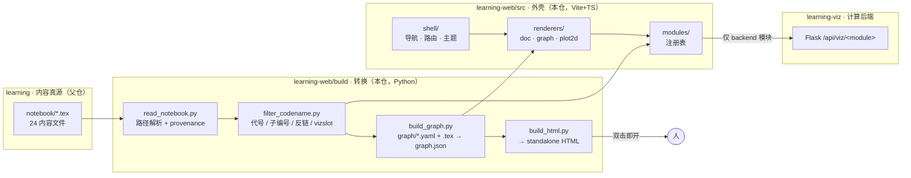

# learning-web — 设计

> **读者**：人 + 编码 agent ｜ **最后更新**：2026-09-22
> **本文放「设计」**：为什么这么分、契约长什么样、数据怎么流、A1 切片怎么验收。
> **规约不在这里** —— 硬规则、分级判据、红线一律看 `AGENTS.md`（入口文件），本文不重述。
>
> 真源约定（唯一一处定义，别处只引用）：
> - 硬规则与判据 → `AGENTS.md`
> - 笔记内容 → `../notebook/*.tex`（只读）
> - 语义边 → `graph/<chapter>.yaml`（本仓，见 `AGENTS.md` §3.4）
> - 进度与 Gate → `../dev-progress.md`

---

## 1. 决策记录

| # | 决策 | 理由 |
|---|---|---|
| D1 | **计算模块**的后端走 `learning-viz/python`（Flask `/api/viz/*`），本仓不自带相关后端 | 沿用父仓 `README.md` 的 `learning ← viz ← web` 三层；单一实现 |
| D2 | 前端 Vite + Vanilla TS，不上 React/Vue | 需要 HMR 调 Canvas/WebGL；单人维护，少一层心智模型 |
| D3 | 可视化计算按 `AGENTS.md` §2 的四问判据分级；**判据 Q1/Q2/Q3 命中即走后端** | 「后端算、前端看」；后端数据可 pytest 对拍 |
| D4 | 第一个切片只做 `A1`，但打穿整条链路（`.tex` → JSON → HTML → 外壳） | 防止全量铺开烂尾；A1 正是数学线 L1 当前所在 |
| D5 | 章节代号（`A1`、`G1.2`）作为路由 ID 与主键 | 绕开父仓 `AGENTS.md` 警告的 `§NN.N` 全局编号漂移 |
| **D6** | **笔记的转换链路整体放本仓 `build/`**（含 `filter_codename.py`、`build_graph.py`、`build_html.py`），不再有 `/api/notes/*` | standalone HTML 本就是纯静态产物、不经 Flask；放本仓不必为它拉起后端。**代价**：D1 的口径收窄为「计算模块走 viz」（AGENTS.md §10 Q2） |
| **D7** | 图谱语义边的真源放**本仓** `graph/<chapter>.yaml` | 与 `build/` 同仓迭代；脱节风险由 `notebook_commit` 校验兜住（AGENTS.md §3.4） |
| **D8** | 公式走**构建期 KaTeX 预渲染**（Node `katex.renderToString`），产物为静态 HTML | `pandoc --katex` 是客户端渲染且默认指向 CDN，与「离线 + 无闪烁 + 可搜 TeX」三项要求都不符（AGENTS.md §7 公式渲染） |

> **D6 与旧的 `learning-viz/python/notes_pipeline/` 方案冲突，以后者为准已废弃。**
> 该目录及其 `DESIGN.md` 已从 `learning-viz` 移除；`learning-viz` 只保留计算模块的后端
> （Flask `/api/viz/*`）与本地渲染。

---

## 2. 数据流



```
learning-web/
  build/                       # Python，走父仓 uv 环境（AGENTS.md §6）
    read_notebook.py
    filter_codename.py
    build_graph.py
    build_html.py
    vendored/                  # KaTeX JS + CSS + 字体
  graph/                       # 语义边真源（本仓）
    <chapter>.yaml
  src/                         # Vite + Vanilla TS
    shell/  renderers/  viz/  modules/  types.ts
  dist/                        # gitignore，可完全重建
    provenance.json
    notes/<code>.html          # 每节碎片
    graph/<chapter>.json
    graph/<chapter>.html       # standalone
  vite.config.ts
```

**两套产物互不依赖**：`build/` 出静态文件（离线可看），`src/` 出 web 外壳（要 dev server）。
先做 `build/`，能双击看到东西了再碰 Vite（`AGENTS.md` §12）。

---

## 3. 溯源：`dist/provenance.json`

```json
{
  "notebook_repo": "/Users/apple/develop/learning",
  "notebook_commit": "66ce26a",
  "notebook_dirty": false,
  "built_at": "2026-09-22T17:20:00+08:00",
  "files": ["A_analysis.tex", "G_numeric.tex"],
  "pandoc_version": "3.x",
  "katex_version": "0.16.x",
  "converter_version": 1
}
```

用途有三，缺一不可：

1. **判断本仓产物是否比笔记旧** —— `notebook_dirty: true` 或 commit 变化即需重建；
2. **校验 `graph/*.yaml` 是否过期** —— 与 yaml 头部的 `notebook_commit` 比对，不一致要告警（`AGENTS.md` §3.4）；
3. **可复现** —— `converter_version` + `pandoc_version` + `katex_version` 三者固定，产物才可复现，
   也才能在 KaTeX 升级后定位「是哪一步改了排版」。

---

## 4. 契约

### 4.1 通用规则

- 每个模块**独立契约 + `version`**（父仓 `README.md` 原则）。
- **必须批量**：一次返回整个参数区间，前端本地 scrub；拖滑块不得逐帧请求。
- 前端计算的模块**必须**带 `computedBy` 并在 UI 上标徽章（`AGENTS.md` §2.3）。
- 契约是**纯数据**：只有数字与字符串，不含函数、不含样式、不含绘制指令。
- **不向后不兼容地改**已定稿的 version（`AGENTS.md` §8 红线）。

### 4.2 消费方与数据源

| 模块 `source` | 取数方式 | 契约产出方 | 正确性保障 |
|---|---|---|---|
| `'frontend'` | 本地 TS 模块直接返回契约对象 | 本仓 `src/viz/*.ts` | 模块内 **invariant 自检** + UI 徽章 |
| `'backend'` | `GET /api/viz/<module>?<params>` | `learning-viz` | `learning-viz` 侧 pytest 对拍 |

两者返回**完全一致的 JSON**，所以迁移只改注册表的 `source` 一个字段（`AGENTS.md` §2.2）。

### 4.3 样例：`convergence-thm`（A1 切片，**前端**实现）

按 `AGENTS.md` §2 判据：Q1 父仓无实现、Q2 弱（∫f_n ≡ 1 显然）、Q3 无 → **前端**。

```json
{
  "module": "convergence-thm",
  "version": 1,
  "computedBy": "frontend",
  "params": { "mode": "bump", "n_min": 1, "n_max": 40 },
  "series": [
    { "n": 1,  "xs": [0, 1],        "ys": [1, 0],       "integral": 1.0 },
    { "n": 40, "xs": [0, 0.025, 1], "ys": [40, 40, 0],  "integral": 1.0 }
  ],
  "assumptions": { "nonneg": true, "monotone": false, "dominated": false },
  "verdict": { "mct": false, "dct": false, "fatou_holds": true },
  "note": "质量挤入宽 1/n、高 n 的尖峰；sup_n f_n 在原点附近无界，无可积控制函数"
}
```

三条必须遵守的约束（**不是建议**）：

1. **批量**：一次给 n ∈ [1,40] 全部序列，不是一条一条取。
2. **`assumptions` 与 `verdict` 由计算方算**，不是前端写死的文案 ——
   这样「假设检查」本身可以被断言（前端走 invariant 自检，后端走 pytest）。
3. **invariant 自检**：`bump` 模式下每条 series 的 `integral` 必须精确等于 1.0，
   偏差 > 1e-12 **抛错**，不静默画图（`AGENTS.md` §2.3）。

> **为什么 A1 切片选前端**：`A1.3`（三大收敛定理）与 `A1.4`（测度论基础）的演示
> 都是「抽掉一个假设看结论怎么失效」，是纯函数图像 + 离散对比，
> 命中判据 Q4，且父仓没有现成实现 —— 放前端才有零往返的拖拽手感。

### 4.4 后端契约的差异

`source: 'backend'` 时 JSON 结构与上例完全一致，只有两处不同：

- `computedBy: "backend"`；
- 取数走 `GET /api/viz/<module>?...`（`learning-viz` Flask，dev 下由 Vite proxy 转发）。

`A1.3`/`A1.4` 之外、命中判据 Q1/Q2/Q3 的模块（如 `G1.2` RK4 vs Verlet）一开始就走后端，
不存在「先前端后迁移」这一步。

---

## 5. A1 垂直切片：验收步骤

> 与 `AGENTS.md` §12 的开工顺序同源，这里只写**验收判据**。
> **每步完成后停下报告，不要连续执行。**

| # | 做什么 | 验收（可执行） |
|---|---|---|
| 1 | `uv add --dev pypandoc-binary`（落在**父仓** `pyproject.toml`） | `uv run python -c "import pypandoc; print(pypandoc.get_pandoc_version())"` 有输出 |
| 2 | `build/read_notebook.py` + `provenance.json` | `dist/provenance.json` 的 `notebook_commit` 与 `../notebook` 的 `git rev-parse --short HEAD` 一致；`notebook_dirty` 正确反映未提交改动 |
| 3 | `build/filter_codename.py`（正则 `[A-R]`）→ 转 A1 | 得到 `A1`、`A1.1`…`A1.5` 共 6 个节点且父链正确；`src.line` 与源文件 `grep` 对得上；**逐一目视比对** `tabular`（A1 内 3 张）/ `\boxed`（1 处）/ 公式上下标，不可只抽查一个 |
| 4 | 手写 `graph/A1.yaml` | 覆盖 A1 的 5 个小目；含 `tension` / `dual` 语义边；`prereq` 子图**无环**（能算出 frontier）；头部 `notebook_commit` 与步骤 2 一致 |
| 5 | `build/build_graph.py` | `dist/graph/A1.json` 里四类边齐全且可分辨；`prereq` 拓扑排序成功；节点 `code` 全部是两级代号 |
| 6 | `build/build_html.py` | `dist/graph/A1.html` **双击**（`file://`）即开：无白屏、无 console 报错、**网络面板无外部请求**（验证 §3.1 三条约束） |
| 7 | 此后才动 `src/`：shell → renderers → viz 注册表 | dev 下 `/api` 代理通；拖滑块**无网络请求**（批量已取回）；徽章与 `computedBy` 一致 |

**步骤 1–3 完成就应能在浏览器里看到一个公式**（打开的是一节 HTML 碎片），
不要等 7 步全做完。步骤 6 的 standalone HTML 是**第一个能拿给人看的东西**。

### 选 A1 的理由

1. `../learning-todo/ns-progress.md` 当前正卡在 **Vitali → Carathéodory → 积分四步构造**，
   恰好落在 `A1.4`；这三关是全篇最适合可视化的（外测度方盒覆盖、Vitali 等价类选择、简单函数逐步逼近）；
2. A1 是全篇地基（A 与 B 是两个根，其余章节全部依赖）；
3. 内容量适中（`A1` 共 5 个小目：A1.1 黎曼→A1.5 L^p），一周可见成果。

**做完切片，学习进度与工程产出是同一件事。**

---

## 6. 分辨率：本文与 AGENTS.md 的边界

| 内容 | 放哪 | 理由 |
|---|---|---|
| 硬规则、四问判据、红线、命令、目录 | `AGENTS.md` | agent 每次都要遵守，必须短 |
| 决策记录（为什么这么分）、契约样例、数据流、验收判据 | 本文 | 只在动手改契约/渲染器时才读 |

若 `AGENTS.md` 超过 ~15 KB，按 `AGENTS.md` §11 把它的 §4（数据结构）挪到本文。
